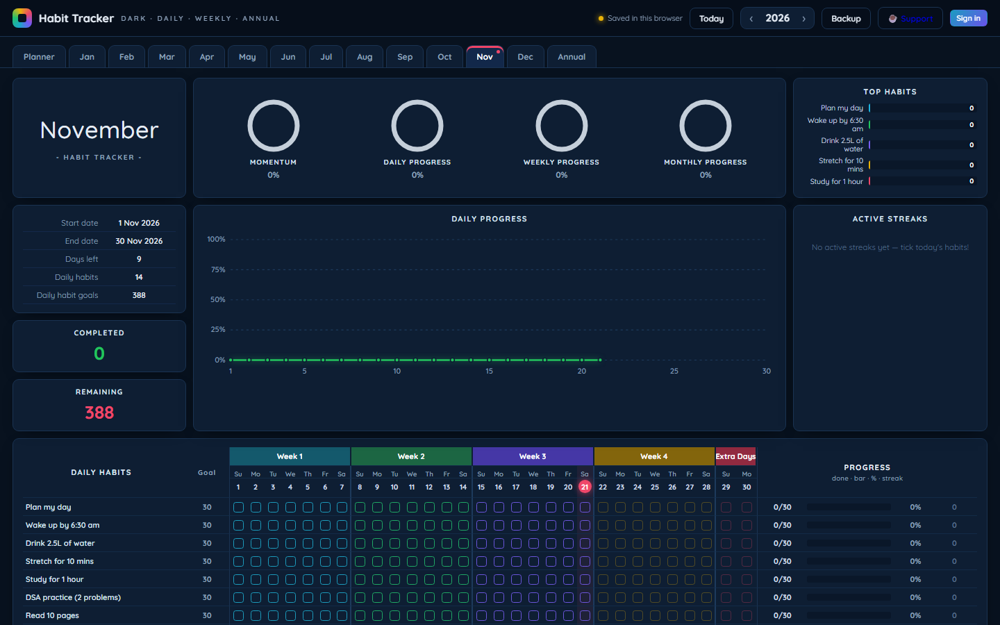

# Habit Tracker

A dark-themed habit tracker that runs in the browser — a yearly planner, 12 monthly dashboards and an annual dashboard — with **Google sign-in** and **cloud sync via [Supabase](https://supabase.com)**.

**Live demo:** https://legend0x01.github.io/habit-tracker/



No build step, no framework: one `index.html`, one `config.js`, one SQL file.

## Features

- **Planner** — daily habits with per-month goals, plus weekly habits switched on per month
- **Monthly dashboard** — tick grid, momentum / daily / weekly / monthly progress rings, daily progress chart, top habits, active streaks, notes
- **Annual dashboard** — goal-vs-done per month, quarterly progress, top habits, weekly-habit breakdown
- **Multi-year** — each year keeps its own data; new years can carry over last year's habits
- **Google sign-in** — data synced to your account and kept private with Postgres row-level security
- **Live sync** — changes on one device show up in your other open tabs and devices
- **Works offline / without an account** — guest mode saves to the browser; sign in later and the data moves into your account
- **Backup & restore** — export/import everything as JSON

## Tech

| Part | Choice |
| --- | --- |
| Frontend | Vanilla HTML, CSS, JavaScript (hand-drawn SVG charts) |
| Auth | Supabase Auth, Google OAuth provider |
| Database | Supabase Postgres, one `jsonb` row per user per year, RLS |
| Sync | Debounced upserts + Supabase Realtime, `localStorage` cache |

## Run it locally

Google sign-in needs `http://` (not `file://`), so serve the folder:

```bash
npx serve .              # → http://localhost:3000
# or
python -m http.server 5173   # → http://localhost:5173
```

With the placeholder `config.js` the app runs in **local-only mode** (no sign-in). Follow the setup below to turn on accounts.

## Set up Supabase + Google sign-in

### 1. Create the Supabase project

1. Create a project at [supabase.com/dashboard](https://supabase.com/dashboard).
2. Open **SQL Editor → New query**, paste [`supabase/schema.sql`](supabase/schema.sql) and click **Run**.
3. Open **Project Settings → API** and copy the **Project URL** and the **anon / publishable key** into [`config.js`](config.js).

> The anon key is meant to be public — row-level security is what protects the data. Never put the `service_role` / secret key in the frontend.

### 2. Create Google OAuth credentials

1. In [Google Cloud Console](https://console.cloud.google.com/) create (or pick) a project.
2. **APIs & Services → OAuth consent screen**: choose *External*, fill in the app name and your email, and add the scopes `openid`, `.../auth/userinfo.email`, `.../auth/userinfo.profile`.
3. **APIs & Services → Credentials → Create credentials → OAuth client ID**, type **Web application**.
   - **Authorized JavaScript origins**: your site URLs, e.g. `http://localhost:3000` and `https://<you>.github.io`
   - **Authorized redirect URIs**: `https://<your-project-ref>.supabase.co/auth/v1/callback`
     (Supabase shows this exact URL on the Google provider page.)
4. Copy the **Client ID** and **Client secret**.

### 3. Turn on Google in Supabase

1. **Authentication → Sign In / Providers → Google**: enable it and paste the Client ID and secret.
2. **Authentication → URL Configuration**:
   - **Site URL**: your production URL (e.g. `https://<you>.github.io/habit-tracker/`)
   - **Redirect URLs**: add every place the app runs, e.g. `http://localhost:3000/**` and `https://<you>.github.io/habit-tracker/**`

Reload the app — you'll see **Continue with Google**.

## Deploy (GitHub Pages)

1. Push this folder to a GitHub repo.
2. **Settings → Pages → Build and deployment**: *Deploy from a branch*, branch `main`, folder `/ (root)`.
3. Add the Pages URL to the Google **Authorized JavaScript origins** and to Supabase **Redirect URLs** / **Site URL**.

Any static host works the same way (Netlify, Vercel, Cloudflare Pages).

## How the data is stored

```
public.habit_years
  user_id    uuid   → auth.users.id   (default auth.uid())
  year       int
  data       jsonb  → { habits, weekly, checks, wchecks, notes, carry, updatedAt }
  updated_at timestamptz
  primary key (user_id, year)
```

Daily check-ins are stored compactly as one `"0"/"1"` string per habit (one character per day of the year). Edits are cached in `localStorage` immediately and upserted to Supabase after a short debounce; when two devices disagree, the copy with the newer `updatedAt` wins.

## Project structure

```
index.html            the whole app (UI, charts, sync)
config.js             your Supabase URL + anon key
supabase/schema.sql   table, row-level security policies, realtime
privacy.html          privacy policy (needed for the Google consent screen)
terms.html            terms of service
assets/               logo (120px for Google branding, 512px favicon)
```

## Support

If this project helps you, you can [☕ buy me a coffee](https://legend0x01.github.io/habit-tracker/support.html) via UPI (no fees, any UPI app).

Self-hosting? Set `upiId` in `config.js` to show your own Support button, or leave it empty to hide it.

## License

[MIT](LICENSE)
