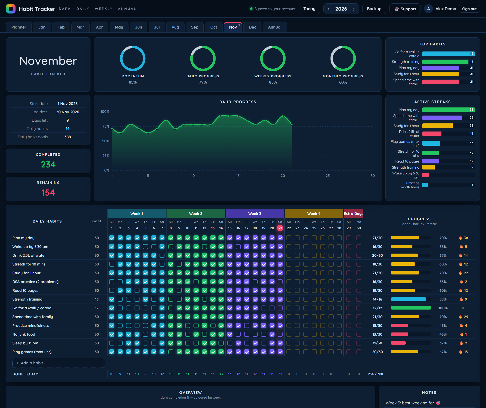
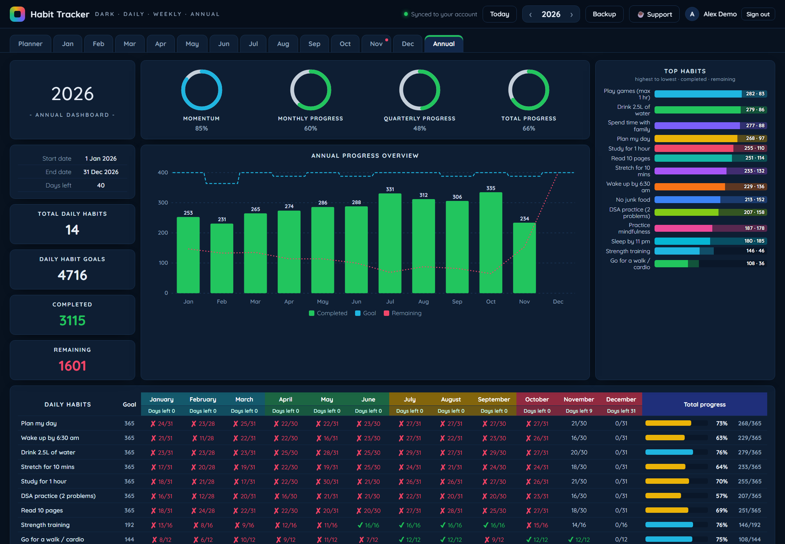
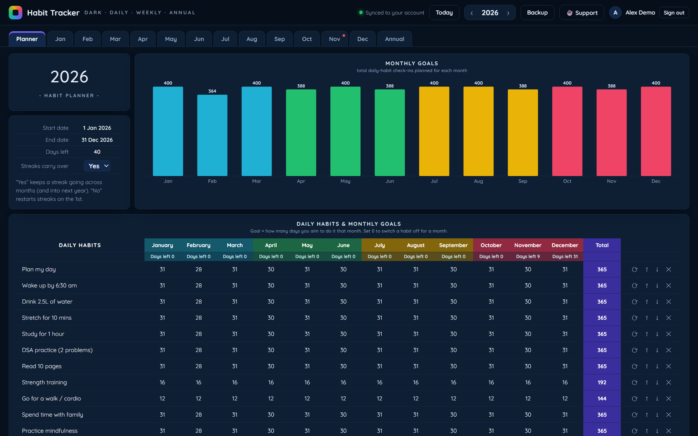
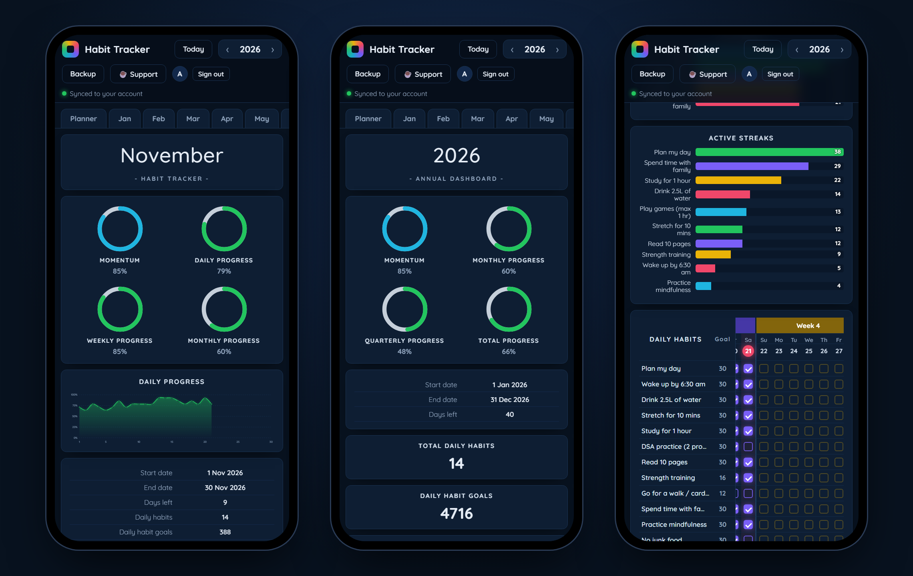
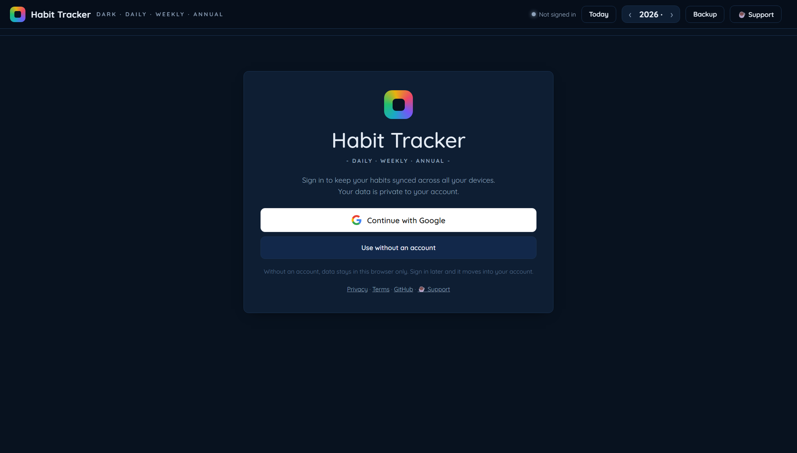
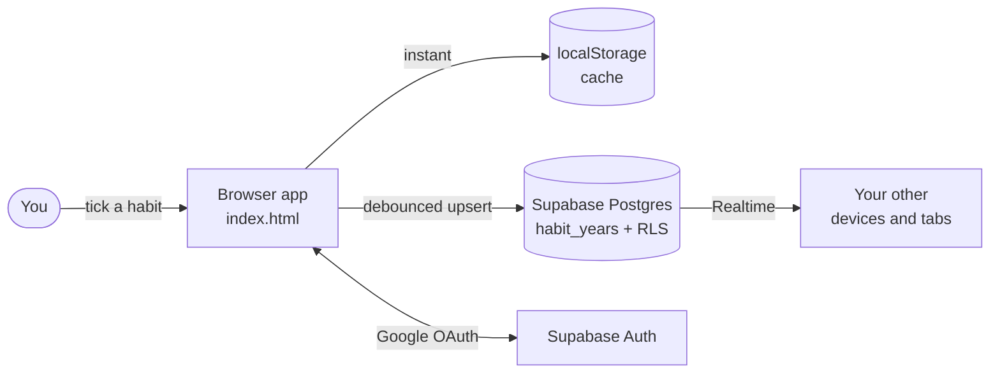

<div align="center">


# Habit Tracker

**Plan your year, tick your days, watch your streaks grow.**

A free, open-source habit tracker with a yearly planner, monthly and annual dashboards,<br>
streaks, Google sign-in and real-time cloud sync. No framework, no build step.

[](https://legend0x01.github.io/habit-tracker/)

[](LICENSE)
[](https://supabase.com)
[](index.html)
[](#-run-it-locally)
[](CONTRIBUTING.md)

[**Live demo**](https://legend0x01.github.io/habit-tracker/) ·
[Features](#-features) ·
[Screenshots](#-screenshots) ·
[Self-host](#-self-host-it) ·
[Roadmap](#-roadmap) ·
[Contributing](CONTRIBUTING.md)

<br>



</div>

<br>

## ✨ Features

**Track**
- **Today**: a one-tap checklist of today's habits, grouped by category; step back to fill in yesterday. Phones open on it
- **Monthly dashboard**: tick grid for every day, grouped by week, with today highlighted
- **Quick add**: type a habit under the grid and press Enter; it's trackable immediately
- **Weekly habits** for things you do once a week (laundry, meal prep, calling family); add, rename or delete them right from the month view
- **Categories and colours**: group daily habits (Health, Study, Work…) and give each group a colour; the tick grid is grouped by category and the charts use its colour
- **Daily reminder**: a notification at the time you choose, only on days when some habits are still unticked. Signed in, it arrives even when the app is closed (Web Push)
- **Notes** for each month: wins, reflections, plans

**Understand**
- **Progress rings**: momentum (7-day rolling), daily, weekly and monthly completion
- **Streaks** per habit, optionally carried across months and into the next year
- **Annual dashboard**: goal vs. done per month, quarterly progress, ✔/✘ per habit per month, top habits, progress by category, weekly-habit breakdown

**Plan**
- **Yearly planner**: set how many days per month you aim to do each habit, or switch a habit off for a month
- **Multi-year**: each year keeps its own data; a new year can carry over last year's habits and goals

**Sync and own your data**
- **Google sign-in** with Supabase Auth; data is private to your account through Postgres row-level security
- **Real-time sync** between your devices and open tabs
- **Guest mode**: use it without an account; sign in later and your data moves into your account
- **Backup and restore** everything as JSON
- **Delete your account** yourself: removes the account and all of its data immediately
- **Light and dark mode**: follows your system setting; switch with the ☀️/🌙 button and it's remembered
- **Installable app (PWA)**: add it to your home screen or desktop; it opens full-screen and works offline
- **Responsive**: works on phones, tablets and desktops

## 📸 Screenshots

<table>
  <tr>
    <td width="50%"><p align="center"><b>Annual dashboard</b></p></td>
    <td width="50%"><p align="center"><b>Yearly planner</b></p></td>
  </tr>
  <tr>
    <td colspan="2"><p align="center"><b>On mobile</b></p></td>
  </tr>
  <tr>
    <td colspan="2"><p align="center"><b>Sign in with Google, or use it without an account</b></p></td>
  </tr>
</table>

<sub>Screenshots use generated demo data.</sub>

## 🧱 Tech stack

| Layer | Choice | Why |
| --- | --- | --- |
| UI | Vanilla HTML, CSS, JavaScript | Zero dependencies to update, loads instantly, easy to read |
| Charts | Hand-written SVG | Rings, line, bar, combo and donut charts in ~100 lines |
| Auth | [Supabase Auth](https://supabase.com/docs/guides/auth) with Google OAuth | Secure sign-in without running a server |
| Database | Supabase Postgres + row-level security | Each user can only ever read and write their own rows |
| Sync | Debounced upserts + Supabase Realtime | Fast local edits, live updates on other devices |
| Offline cache | `localStorage` + a service worker | Instant load, opens and keeps working with no network |
| Reminders | Notifications API, scheduled in the page | No push server needed |
| Hosting | GitHub Pages | Free static hosting |

## 🔧 How it works



- Every edit is written to `localStorage` immediately and sent to Supabase about 0.7 s later.
- Each **year is one row** (`user_id`, `year`, `data jsonb`). When two devices both changed a year, their edits are merged: each device remembers the last copy it agreed on with the cloud, so a three-way merge keeps changes from both (ticks day by day, habits and categories by id). If both changed the very same value, the device that's saving wins.
- The service worker caches the app, so it opens offline. Pages are fetched network-first, so a new deploy shows up on the next visit. Supabase requests are never cached.
- Reminders are checked every 30 seconds while the app is open or in a background tab. Phones pause apps that aren't in use, so a fully closed app can't remind you; that would need Web Push from a server.
- Daily check-ins are stored compactly as one `"0"/"1"` string per habit, one character per day of the year.
- Row-level security policies in [`supabase/schema.sql`](supabase/schema.sql) restrict every query to `auth.uid() = user_id`.

<details>
<summary><b>Data model</b></summary>

```text
public.habit_years
  user_id    uuid         → auth.users.id   (default auth.uid())
  year       int
  data       jsonb        → { habits, cats, weekly, checks, wchecks, notes, carry, updatedAt }
                            habits[i] = { id, name, cat, goals[12] }, cats[i] = { id, name, col }
  updated_at timestamptz
  primary key (user_id, year)
```
</details>

## 🚀 Run it locally

Google sign-in needs `http://`, not `file://`, so serve the folder:

```bash
git clone https://github.com/legend0x01/habit-tracker.git
cd habit-tracker
python -m http.server 3000      # or: npx serve -l 3000 .
```

Open <http://localhost:3000>. To run your own copy, put your Supabase keys in `config.js` (see below). If you put placeholder values there (e.g. `YOUR_PROJECT_REF`), the app runs in **local-only mode**: no sign-in, data saved in the browser.

Run the tests (Node 20 or newer, nothing to install):

```bash
npm test        # or: node --test
```

They cover the sync merge in `merge.js` and check that everything the page loads is cached for offline use. GitHub Actions runs them on every push.

## 🧰 Self-host it

You'll need a free [Supabase](https://supabase.com) project and a Google Cloud OAuth client. It takes about 15 minutes.

<details>
<summary><b>1. Supabase project and database</b></summary>

1. Create a project at [supabase.com/dashboard](https://supabase.com/dashboard).
2. **SQL Editor → New query**: paste [`supabase/schema.sql`](supabase/schema.sql) and click **Run**.
3. **Project Settings → API Keys**: copy the **Project URL** and the **publishable / anon** key into [`config.js`](config.js).

> The publishable key is meant to be public. Row-level security protects the data. Never put the `service_role` / secret key in frontend code.
</details>

<details>
<summary><b>2. Google OAuth client</b></summary>

1. In [Google Cloud Console](https://console.cloud.google.com/), create a project and open **Google Auth Platform → Get started** (External audience).
2. **Branding**: add your home page, privacy policy and terms URLs, plus authorised domains `<project-ref>.supabase.co` and your site's domain.
3. **Clients → Create client → Web application**:
   - Authorized JavaScript origins: `http://localhost:3000`, `https://<you>.github.io`
   - Authorized redirect URI: `https://<project-ref>.supabase.co/auth/v1/callback`
4. **Audience → Publish app**.
</details>

<details>
<summary><b>3. Connect Google to Supabase</b></summary>

1. **Authentication → Sign In / Providers → Google**: enable it and paste the Client ID and secret.
2. **Authentication → URL Configuration**:
   - Site URL: `https://<you>.github.io/habit-tracker/`
   - Redirect URLs: `http://localhost:3000/**` and `https://<you>.github.io/habit-tracker/**`
</details>

<details>
<summary><b>4. Deploy to GitHub Pages</b></summary>

1. Push the repo to GitHub.
2. **Settings → Pages**: deploy from branch `main`, folder `/ (root)`.
3. Every push to `main` redeploys in about a minute.

Any static host works the same way: Netlify, Vercel, Cloudflare Pages.
</details>

<details>
<summary><b>5. Push reminders (optional)</b></summary>

Lets the daily reminder arrive when the app is closed. Without it, reminders work while the app is open. Needs [Node.js](https://nodejs.org) for the Supabase CLI.

1. **Keys.** Make a VAPID key pair and a cron secret (Node 20+, run in the repo folder):
   ```bash
   node -e 'const {subtle}=crypto;subtle.generateKey({name:"ECDSA",namedCurve:"P-256"},true,["sign","verify"]).then(async k=>{const j={publicKey:await subtle.exportKey("jwk",k.publicKey),privateKey:await subtle.exportKey("jwk",k.privateKey)};require("fs").mkdirSync("supabase/.local",{recursive:true});require("fs").writeFileSync("supabase/.local/reminders.env",`VAPID_KEYS=${JSON.stringify(JSON.stringify(j))}\nVAPID_SUBJECT="https://your-site.example/"\nCRON_SECRET="${require("crypto").randomBytes(32).toString("base64url")}"\n`);console.log("vapidPublicKey:",Buffer.from(await subtle.exportKey("raw",k.publicKey)).toString("base64url"))})'
   ```
   Put the printed key in `vapidPublicKey` in `config.js`. `supabase/.local/` is git-ignored: never commit it.
2. **Database.** Run [`supabase/schema.sql`](supabase/schema.sql) again (it adds `push_subscriptions`).
3. **Function.**
   ```bash
   npx supabase login
   npx supabase link --project-ref <project-ref>
   npx supabase secrets set --env-file supabase/.local/reminders.env
   npx supabase functions deploy send-reminders --no-verify-jwt
   ```
   `--no-verify-jwt` is intended: the function checks `CRON_SECRET` itself.
4. **Schedule.** In **Database → Extensions** enable `pg_cron` and `pg_net`. Then in the SQL Editor run [`supabase/reminders-cron.sql`](supabase/reminders-cron.sql) with `<project-ref>` and `<cron-secret>` (the `CRON_SECRET` value) filled in.
5. **Check.** Edge Functions → send-reminders → Logs should show a run every 5 minutes. Each returns `{"checked","sent","allDone","removed","failed"}`.
</details>

## 📁 Project structure

```text
├── index.html            the app: UI, charts, sync
├── merge.js              three-way merge used when two devices edited the same year
├── config.js             Supabase URL + publishable key, optional UPI ID
├── manifest.webmanifest  app name, icons and colours for installing
├── sw.js                 service worker: offline cache, push reminders, notification clicks
├── supabase/schema.sql   tables, row-level security policies, realtime, account deletion
├── supabase/functions/send-reminders/   Edge Function that sends push reminders
├── supabase/reminders-cron.sql          runs it every 5 minutes (pg_cron)
├── tests/                node --test suites (merge logic, offline cache, reminder rules)
├── support.html          "buy me a coffee" page (UPI QR)
├── privacy.html          privacy policy (needed for Google sign-in)
├── terms.html            terms of service
├── assets/               logo, favicon, social preview image
└── docs/screenshots/     README images
```

## 🧭 Roadmap

- [x] Google sign-in and cloud sync
- [x] Real-time sync across devices
- [x] Quick-add habits from the monthly grid
- [x] Installable app (PWA) with offline support
- [x] Daily reminder notifications
- [x] Reminders when the app is fully closed (Web Push)
- [ ] Export a month or year as CSV / PDF
- [x] Light and dark theme
- [x] Habit categories and colours

Have an idea? [Open an issue](https://github.com/legend0x01/habit-tracker/issues/new/choose).

## 🤝 Contributing

Contributions are welcome. Read [CONTRIBUTING.md](CONTRIBUTING.md) to get started, and please report security issues privately as described in [SECURITY.md](SECURITY.md).

## ☕ Support

If this project helps you, you can [buy me a coffee](https://legend0x01.github.io/habit-tracker/support.html) via UPI. A ⭐ on the repo helps too.

## 📄 License

[MIT](LICENSE) © legend0x01
